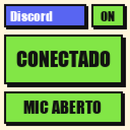

# titorion-custom-screen


Source: https://github.com/RicckVale/titorion-custom-screen

## Notice

I made this out of pure curiosity. I do not hold, and this project does not grant, any copyright, trademark, or other right belonging to Titorion, Shop Borges Comercial LTDA, or anyone else. The Titorion name, the Saiph keyboard, and their marks stay theirs. Nothing here is affiliated with, endorsed by, or authorized by Titorion.

If you run this software, you do it of your own free will and at your own risk. It talks to the keyboard with the same kind of screen packets as the official web driver. A bad or interrupted write can freeze the little display until you reconnect the cable. Close the official Titorion app before you connect from here.

## What it is

Homemade tools for the little screen on the **Titorion Saiph** keyboard (USB VID `0x379A`, PID `0x0920`, product `"Saiph Keyboard"`). The screen is **128×128 pixels**, RGB565.

The starting point was the official web driver, `https://titorion.i-game.tech/`. What this program sends to the keyboard is written in [`docs/protocol.md`](docs/protocol.md). A new packet, outside that flow, does not go in without a capture from the official driver.

## What it does

Screen Studio sits in the Windows tray, with the project logo, and follows the front window. The program window does not need to stay open.


| Front window  | What shows on the screen                                                                                                                     |
| ------------- | -------------------------------------------------------------------------------------------------------------------------------------------- |
| Cursor        | Account quota: Auto in front, API next, included in the corner. Green up to 50%, yellow up to 75%, red above that.                           |
| Claude        | Claude limit: the week (all models) in front, the session below, time until reset on the sticker. Header in the app's orange, with the star. |
| Discord       | Online, in a voice conversation or not, and the mic (open, muted, or not in a call). Header in blurple.                                      |
| Spotify       | The track that is playing: title, artist, and whether it is playing or paused. Header in Spotify green.                                     |
| Anything else | Clock, CPU, and RAM, on the same kind of card.                                                                                               |

The same three cards, at the size the keyboard draws them:

| Cursor | Claude | Anything else |
|---|---|---|
|  |  |  |

The numbers come from the session already open on the computer. No fixed quota in the code, and no token is stored in this repository. A reading is cached for 60 seconds. If the session cannot be read, the card still goes out and the tray log says the quota was not read.

Which account is read depends on the front window, not on an app that is only open behind it. Cursor in front reads Cursor. Claude in front reads Claude.

### Discord

With the Discord window in front, the keyboard shows that card: **ON** or **OFF**, **CONECTADO** or **LIVRE** (in English, **IN CALL** or **IDLE**), and the mic. The executable names are `discordApps` in `config/screen.json`.

| Not in a call | In a call, mic open | In a call, mic muted |
|---|---|---|
|  |  |  |

A voice conversation takes the screen over the clock and over Cursor or Claude. Leave the call and the keyboard goes back to whatever is in front.

Online means Discord has a live TCP connection. In a call means it has a UDP socket to another machine. The mic is the Windows capture session of that process, and it is only shown during the call: open, muted, or no capture session. Nothing from the account is written into this repository.

### Spotify

The card reads the Windows media session for the apps in `spotifyApps`. No Spotify account and no token.

Playing:


Paused, with Spotify in front:


Nothing playing:


While a track is **playing**, this card replaces the clock. Cursor, Claude, and a Discord voice call stay in front of it. If Spotify is the front window, the card also shows a paused track, or **SEM MUSICA** / **NOTHING** when there is no track. The title wraps to two lines. A longer name is cut with `..`.

### Cursor

The editor keeps its login in `%APPDATA%\Cursor\User\globalStorage\state.vscdb`, under the key `cursorAuth/accessToken`. Screen Studio opens that database read-only and sends the token as a Bearer header. It does not copy the token into this project.

The request is a POST to the URL in `config/screen.json` (`usageUrl`), body `{}`, with `Content-Type: application/json` and `Connect-Protocol-Version: 1`. The live address is `GetCurrentPeriodUsage` on `api2.cursor.sh`.

From the reply, the card uses:


| On screen               | Field                                                  |
| ----------------------- | ------------------------------------------------------ |
| Included, in the corner | `planUsage.includedSpend` divided by `planUsage.limit` |
| API                     | `planUsage.apiPercentUsed`                             |
| Auto, in front          | `planUsage.autoPercentUsed`                            |
| Days left               | `billingCycleEnd`, turned into whole days              |


That endpoint returns percentages for the billing period. It does not return a raw token counter.

### Claude

The desktop app keeps the claude.ai session in `%LOCALAPPDATA%\Claude-Data\<profile>\`. Screen Studio picks the profile that has both `Network\Cookies` and `Local State`, using the cookie file that was written most recently. The organization id is the `lastActiveOrg` cookie. The session cookie has to be present. Neither value is written into this repository.

While Claude is open it locks the cookie database. The program then reads the file through the handle the app already holds, instead of waiting for the lock to drop. The key in `Local State` is unprotected with Windows DPAPI, and each cookie value is decrypted with that key. Cookies for other sites are ignored.

The request is a GET to the URL in `config/screen.json` (`claudeUsageUrl`), with `{org}` replaced by that organization. The live address is `https://claude.ai/api/organizations/{org}/usage`. The call is made with a browser-like client. A plain HTTP library is stopped by Cloudflare before the usage JSON comes back.

From the reply, the card uses:


| On screen                        | Field                                                                                                      |
| -------------------------------- | ---------------------------------------------------------------------------------------------------------- |
| Week, all models, in front       | `limits[]` where `kind` is `weekly_all`, field `percent`. If that list is missing, `seven_day.utilization` |
| Session, below                   | `limits[]` where `kind` is `session`, field `percent`. If that list is missing, `five_hour.utilization`    |
| Time until reset, on the sticker | `resets_at` of the weekly limit, shown as minutes, hours, or days                                          |


An organization that only has API access, and not the chat session, does not return this usage. The Claude window has to be the one in front. Claude running behind Cursor still counts as Cursor.

Each send **adds** an image to the screen's storage. It does not replace the previous one. The swap follows this order:

1. Upload the new image while the current one stays visible.
2. Switch the screen to that new image.
3. Delete the previous one and ask for the picture page again.

Deleting the image on screen, or ending up with none, drops the keyboard onto the firmware's purple clock. A **LOADING** poster stays stored as the first image for that gap.

## How to run

You need Windows, the keyboard on USB, and the official Titorion app **closed**.

### Screen Studio (everyday use)

Clone the repository and install the dependencies:

```powershell
git clone https://github.com/RicckVale/titorion-custom-screen.git
cd titorion-custom-screen
python -m venv .venv
.\.venv\Scripts\python.exe -m pip install -r requirements.txt
```

Double-click `Screen Studio.bat`.

The program starts with no window. The logo sits near the clock (sometimes hidden behind the tray arrow). Double-click it to open the preview, the log, and a one-off image send. Closing that window only hides it. **Quit**, on the icon menu, is what exits and releases the keyboard.

**PT** and **EN** in that window switch the language of the cards and of the window. SEMANA becomes WEEK, SESSAO becomes SESSION, and the other labels follow. The choice is saved in `config/screen.json` (`language`) and the keyboard gets the new card on the next send.

### Start with Windows

To start Screen Studio at login, put a shortcut to `Screen Studio.bat` in:

```text
%APPDATA%\Microsoft\Windows\Start Menu\Programs\Startup
```

To turn that off, delete the `Titorion Screen` shortcut from that folder. A copy that is already running stays up until you choose **Quit** in the tray.

### In the browser

Open `tools/web/index.html` in Chrome or Edge, connect the keyboard, and send an image. That is for a one-off send. It does not follow the focused window.

### From the terminal

```powershell
.\.venv\Scripts\python.exe src\check_device.py
.\.venv\Scripts\python.exe src\demo_static.py path\to\image.png
.\.venv\Scripts\python.exe src\demo_stats.py
```

`check_device.py` only lists the HID device. It sends nothing.

## How to make a new screen

The steps are in [`docs/tecnicos/tela.md`](docs/tecnicos/tela.md): the 128×128 size, where to draw, how a mode change goes out immediately, and the send order that avoids the clock.

## Map

```text
Screen Studio.bat          starts the program with no terminal
assets/                    project logo and the three screen previews
config/screen.json         watched apps, quota URLs, and language (pt or en)
src/app.py                 tray and window
src/i18n.py                Portuguese and English labels
src/screen_frame.py        picks the image from the focused window
src/discord_status.py      Discord online, call, and mic
src/spotify_now.py         Spotify track from the Windows media session
src/stats_render.py        draws the cards
src/titorion_screen.py     screen protocol
src/active_app.py          front window
src/usage_quota.py         Cursor quota
src/claude_quota.py        Claude quota
docs/protocol.md           HID packets, source of truth
docs/tecnicos/tela.md      how to create a screen
tools/web/index.html       one-off send in the browser
```

## Not done yet

Animated GIF, and remapping a key per application. Those commands were not captured from the official driver, so they stay out.