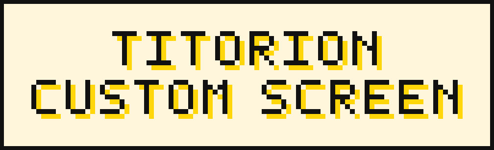
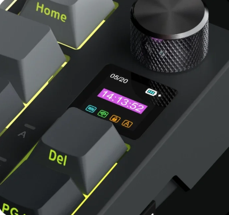
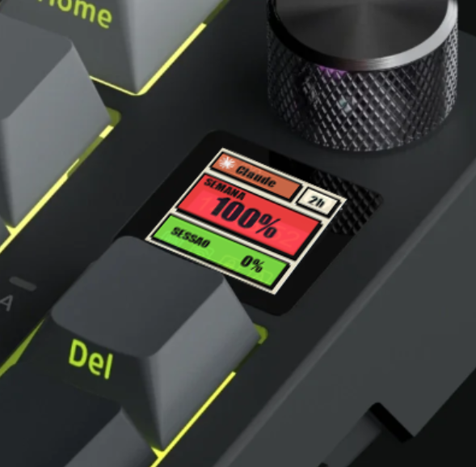
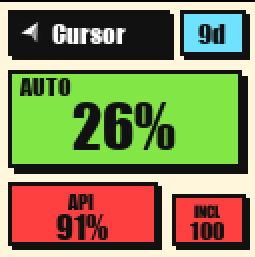
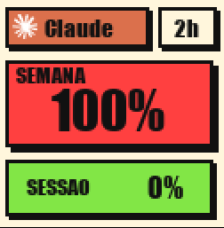
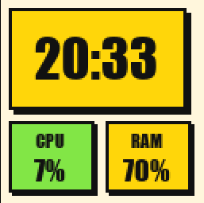
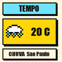
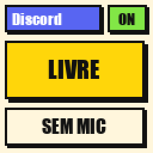
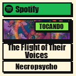
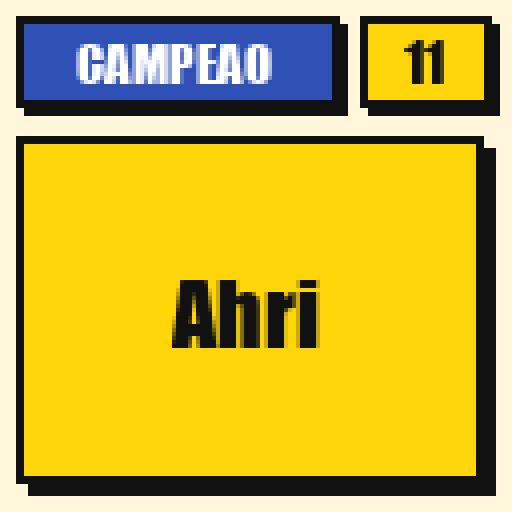

# titorion-custom-screen



Cartazes ao vivo na telinha do **Titorion Saiph**. O Screen Studio fica na bandeja do Windows e troca o desenho conforme a janela da frente.

A tela de fábrica, e a mesma foto com o cartaz do Claude nesse lugar:

| Antes | Depois |
|---|---|
|  |  |

## Cartazes

| Cursor | Claude | Relógio e tempo |
|---|---|---|
|  |  | <br> |

| Discord, sem chamada | Spotify, tocando | League, na partida |
|---|---|---|
|  |  |  |

| Janela da frente | O que aparece |
|---|---|
| Cursor | Cota da conta: Auto, API e o incluído. Verde até 50%, amarelo até 75%, vermelho acima. |
| Claude | A semana de todos os modelos, a sessão, e o tempo até reiniciar. |
| Discord | Online, em chamada ou livre, e o microfone. Numa chamada, reveza com o outro cartaz, cerca de 10 segundos cada. |
| Spotify | Faixa, artista e a capa, tocando ou em pausa. Tocando, entra no lugar do relógio. |
| League | O campeão da partida, com o nível. |
| Qualquer outra | Relógio, CPU e RAM, revezando com o tempo. O intervalo é `weatherTurnSeconds` em `config/screen.json`, no mínimo 10 segundos. |

Os números saem da sessão já aberta neste computador. Não há cota fixa no código, e nenhum token fica neste repositório. **PT** e **EN**, na janela do programa, trocam o texto dos cartazes. De onde vem cada número: [`docs/tecnicos/tela.md`](docs/tecnicos/tela.md).

## Como rodar

Windows, o teclado no USB, e nenhum outro programa usando o teclado.

```powershell
git clone https://github.com/RicckVale/titorion-custom-screen.git
cd titorion-custom-screen
python -m venv .venv
.\.venv\Scripts\python.exe -m pip install -r requirements.txt
```

Duplo clique em `Screen Studio.bat`. O programa abre sem janela. A logo fica perto do relógio. Duplo clique nela abre o preview e o log. Fechar essa janela só esconde. **Sair**, no menu do ícone, encerra e solta o teclado.

Para abrir no login, um atalho de `Screen Studio.bat` em:

```text
%APPDATA%\Microsoft\Windows\Start Menu\Programs\Startup
```

Apagar o atalho `Titorion Screen` dessa pasta desliga a abertura automática. Uma cópia que já está rodando continua até você escolher **Sair**.

Envio de uma imagem só, sem seguir a janela: abra `tools/web/index.html` no Chrome ou no Edge. Pelo terminal:

```powershell
.\.venv\Scripts\python.exe src\check_device.py
.\.venv\Scripts\python.exe src\demo_static.py path\to\image.png
```

`check_device.py` só lista o dispositivo. Não envia nada.

## Teclado

Titorion Saiph, USB `0x379A` / `0x0920`, tela **128×128** RGB565. Os pacotes estão em [`docs/protocol.md`](docs/protocol.md). Um pacote novo, fora desse fluxo, não entra sem uma captura já conferida.

```text
Screen Studio.bat          sobe o programa sem terminal
config/screen.json         aplicativos observados, URLs de cota e idioma
src/app.py                 bandeja e janela
src/screen_frame.py        escolhe a imagem pela janela em foco
src/stats_render.py        desenha os cartazes
src/titorion_screen.py     protocolo da tela
docs/protocol.md           pacotes HID
docs/tecnicos/tela.md      como criar uma tela, e de onde vem cada número
tools/web/index.html       envio avulso no navegador
```

## Ainda não

GIF animado, e remapear uma tecla por aplicativo. Esses comandos ainda não foram capturados. A cor das teclas conforme a skill do League também fica de fora: a partida não diz se a skill está pronta, e o pacote de luz do teclado ainda não foi capturado.

## Aviso

Fiz isto por pura curiosidade. Este projeto não é filiado, endossado nem autorizado por ninguém. As marcas citadas continuam dos respectivos donos. O programa só lê o que já está aberto neste computador para desenhar um cartaz.

Se você rodar este software, faz isso por livre e espontânea vontade e por sua conta e risco. Uma escrita ruim ou interrompida pode travar o visor até você reconectar o cabo. Feche qualquer outro programa que esteja usando o teclado antes de conectar por aqui.
