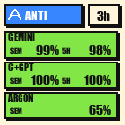

# titorion-custom-screen


Cartazes ao vivo na telinha do **Titorion Saiph** e no **Smart Weather Clock** Wi-Fi. O Screen Studio fica na bandeja do Windows e troca o desenho conforme a janela da frente. O mesmo cartaz vai para o teclado e para o relógio. Se um deles estiver desligado, o outro continua.

A tela de fábrica, e a mesma foto com o cartaz do Claude nesse lugar:

| Antes | Depois |
|---|---|
|  |  |

## Cartazes

| Cursor | Claude | Antigravity |
|---|---|---|
|  |  |  |

| Discord, sem chamada | Spotify, tocando | League, na partida |
|---|---|---|
|  |  |  |

| Relógio e tempo |  |  |
|---|---|---|
| <br> |  |  |

| Janela da frente | O que aparece |
|---|---|
| Cursor | Cota da conta: Auto, API e o incluído. Verde até 50%, amarelo até 75%, vermelho acima. |
| Claude | A semana de todos os modelos, a sessão, e o tempo até reiniciar. |
| Antigravity | O que ainda resta na semana e nas 5 horas, por grupo. Verde até 50% de uso, amarelo até 75%, vermelho acima. |
| Discord | Online, em chamada ou livre, e o microfone. Numa chamada, reveza com o outro cartaz, cerca de 10 segundos cada. |
| Spotify | Faixa, artista e a capa. Na frente, mostra também a pausa. Tocando, reveza com o cartaz da vez, no mesmo intervalo do tempo. O campeão da partida não sai. |
| League | O campeão da partida, com o nível. |
| Qualquer outra | Relógio, CPU e RAM, revezando com o tempo. O intervalo é `weatherTurnSeconds` em `config/screen.json`, no mínimo 10 segundos. Uma faixa tocando entra nessa troca. |

Os números saem da sessão já aberta neste computador. Não há cota fixa no código, e nenhum token fica neste repositório. **PT** e **EN**, na janela do programa, trocam o texto dos cartazes. De onde vem cada número: [`docs/tecnicos/tela.md`](docs/tecnicos/tela.md).

## Como rodar

Windows, o teclado no USB, e nenhum outro programa usando o teclado. O relógio precisa estar na mesma rede Wi-Fi que o PC (veja [Relógio Wi-Fi](#relógio-wi-fi)).

```powershell
git clone https://github.com/RicckVale/titorion-custom-screen.git
cd titorion-custom-screen
python -m venv .venv
.\.venv\Scripts\python.exe -m pip install -r requirements.txt
```

Duplo clique em `Screen Studio.bat`. O programa abre sem janela. A logo fica perto do relógio. Duplo clique nela abre o preview e o log. Fechar essa janela só esconde. **Sair**, no menu do ícone, encerra, solta o teclado e devolve o relógio Wi-Fi como estava.

Para abrir no login, um atalho de `Screen Studio.bat` em:

```text
%APPDATA%\Microsoft\Windows\Start Menu\Programs\Startup
```

Apagar o atalho `Titorion Screen` dessa pasta desliga a abertura automática. Uma cópia que já está rodando continua até você escolher **Sair**.

Envio de uma imagem só, sem seguir a janela: abra `tools/web/index.html` no Chrome ou no Edge. Pelo terminal:

```powershell
.\.venv\Scripts\python.exe src\check_device.py
.\.venv\Scripts\python.exe src\demo_static.py path\to\image.png
```

`check_device.py` só lista o dispositivo. Não envia nada.

## Teclado

Titorion Saiph, USB `0x379A` / `0x0920`, tela **128×128** RGB565. Os pacotes estão em [`docs/protocol.md`](docs/protocol.md). Um pacote novo, fora desse fluxo, não entra sem uma captura já conferida.

```text
Screen Studio.bat          sobe o programa sem terminal
config/screen.json         aplicativos observados, URLs de cota e idioma
src/app.py                 bandeja e janela
src/screen_frame.py        escolhe a imagem pela janela em foco
src/stats_render.py        desenha os cartazes
src/titorion_screen.py     protocolo da tela
docs/protocol.md           pacotes HID
docs/tecnicos/tela.md      como criar uma tela, e de onde vem cada número
tools/web/index.html       envio avulso no navegador
```

## Relógio Wi-Fi

O **Smart Weather Clock** (relógio Wi-Fi com tela 240×240, firmware de fábrica [SD PRO](https://github.com/JUZIPi-tech/SD_PRO)) recebe os mesmos cartazes pelo Wi-Fi. Não precisa trocar o firmware nem usar cabo: o programa usa a mesma API da página web do relógio.

Em `config/screen.json`:

```json
"displays": ["keyboard", "clock"],
"clockHost": "192.168.25.62"
```

`displays` escolhe as telas: só `["clock"]` funciona sem o teclado. `clockHost` é o IP do relógio. Ele aparece na tela durante a inicialização, ou na lista de aparelhos do roteador. Vale reservar esse IP no roteador.

Teste rápido, antes de abrir o Screen Studio:

```powershell
.\.venv\Scripts\python.exe src\check_clock.py           # só lê temas e fotos
.\.venv\Scripts\python.exe src\check_clock.py --send    # um cartaz vermelho e um verde, depois devolve o relógio
```

Como funciona: o firmware não deixa desenhar na tela, mas tem o tema **Photo**, um slideshow de JPGs. Enquanto o programa roda, o relógio fica só nesse tema com duas fotos dele:

- `ts_live_base.jpg`, o cartaz "carregando", que cobre a tela durante a gravação;
- `ts_live_card.jpg`, o cartaz da vez, sobrescrito a cada troca.

Nada é apagado durante o uso. Apagar uma foto do slideshow deixa a tela em "No File". As suas fotos ficam desligadas, não apagadas. O estado original (temas, fotos ligadas e intervalo) fica em `config/clock_state.json`. **Sair** devolve tudo e apaga as duas fotos. Se o PC desligar com o programa aberto, o relógio fica no último cartaz até o programa abrir de novo.

Diferenças do teclado:

- O cartaz é desenhado em 128×128 e ampliado para 240×240. Fica um pouco menos nítido.
- A troca aparece no próximo ciclo do slideshow, até 5 segundos depois.
- Cada cartaz é gravado na memória do relógio. Por isso vale o mesmo mínimo de 10 segundos entre envios.

```text
src/clock_screen.py        API do relógio (tema Photo)
src/displays.py            manda o cartaz para o teclado e o relógio
src/check_clock.py         teste do relógio
```

## Ainda não

GIF animado, e remapear uma tecla por aplicativo. Esses comandos ainda não foram capturados. No relógio, trocas mais rápidas que 5 segundos pediriam um firmware próprio. A cor das teclas conforme a skill do League também fica de fora: a partida não diz se a skill está pronta, e o pacote de luz do teclado ainda não foi capturado.

## Aviso

Fiz isto por pura curiosidade. Este projeto não é filiado, endossado nem autorizado por ninguém. As marcas citadas continuam dos respectivos donos. O programa só lê o que já está aberto neste computador para desenhar um cartaz.

Se você rodar este software, faz isso por livre e espontânea vontade e por sua conta e risco. Uma escrita ruim ou interrompida pode travar o visor até você reconectar o cabo. Feche qualquer outro programa que esteja usando o teclado antes de conectar por aqui. No relógio, evite mexer na página de fotos dele com o programa aberto.
